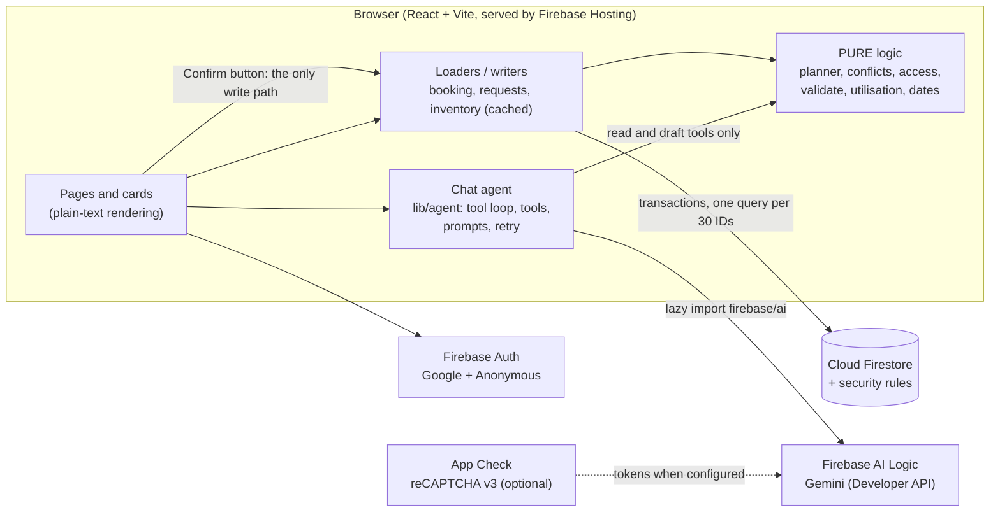

# LabLink


**Making college laboratories more accessible.** LabLink is a campus lab resource-sharing platform
with a GenAI assistant at its centre. A student describes what they want to build ("I want to heat an
acid for my project"); the assistant finds the right equipment across departments, offers equivalent
substitutes when something is taken, plans sessions where every item is free together, and prepares
the booking or the faculty access request. **Nothing is written until a human presses Confirm.**
Hazardous work always goes through faculty, and when students clash over the same equipment a fair,
explainable formula decides who gets it and re-plans alternatives for everyone else.

## How LabLink solves the problem

| Problem statement phrase                                                                        | LabLink feature                                                                                                                                                                                  | Where                                   | Evidence                                                                                     |
| ----------------------------------------------------------------------------------------------- | ------------------------------------------------------------------------------------------------------------------------------------------------------------------------------------------------ | --------------------------------------- | -------------------------------------------------------------------------------------------- |
| GenAI-powered                                                                                   | Chat agent with function calling, grounded on inventory and experiments; AI allocation explanation                                                                                               | `src/lib/agent/*`, Chat, Conflicts      | Demo prompts below; `recommend.test.js`, `tools.test.js`, `agent.test.js`, `explain.test.js` |
| Discover specialised equipment, development kits and workstations **across departments**        | Catalogue with search autocomplete, department, category, access and "free on" filters; `recommend_equipment`; seed covers 4 departments                                                         | Catalogue, Chat                         | `inventory.test.js`, `validate.test.js`, `seed.test.js`                                      |
| **Intelligent slot booking**                                                                    | Multi-equipment co-scheduling planner, capacity-aware hourly booking, substitution by equivalent group, headroom-aware start times                                                               | `planner.js`, `booking.js`              | `planner.test.js`, `booking.test.js`                                                         |
| **Project-based access requests**                                                               | Projects and requests created from chat drafts, open vs approval tiers, hazard rule                                                                                                              | `requests.js`, `access.js`, My Requests | `access.test.js`, `requests.test.js`, rules tests                                            |
| **Faculty approvals**                                                                           | Approval queue with approve / reject (comment required) and a conflict lock                                                                                                                      | Approval queue                          | `Conflicts.test.jsx`, `StaffPages.test.jsx`, rules tests                                     |
| **Optimising resource utilisation**                                                             | Quantity-based capacity, substitution of idle equivalents, headroom-aware placement, "Quiet / Busy this week" badges                                                                             | `utilisation.js`, Catalogue             | `utilisation.test.js`                                                                        |
| **Intelligently resolve scheduling conflicts**                                                  | Conflict detection by connected components (union-find) over over-demanded hours                                                                                                                 | `conflicts.js`, Conflicts page          | `conflicts.test.js`                                                                          |
| **Fair and feasible allocations** based on **deadlines, availability and student requirements** | Score = urgency (deadline) + fairness (recent usage) + stage; all-or-nothing feasibility; losers get re-planned alternatives that fit their own sessions and deadline; plain-English explanation | `conflicts.js`, `agent/explain.js`      | Seeded clash: Aarav 0.86 > Rohan 0.62 > Meera 0.36 in `conflicts.test.js`                    |

## Architecture



- **The model can only read and propose.** Tools return data and draft cards; every write happens in
  plain code behind a Confirm button, re-validated against fresh data.
- **Business logic is pure and tested** (`src/lib/*.js` marked PURE); Firestore access lives in
  separate loader and writer functions.
- **No backend server.** Firestore transactions keep bookings all-or-nothing; security rules enforce
  ownership, shapes and the hazard invariant.

## Security notes

- **Firestore rules** (`firestore.rules`): default deny, signed-in reads, owner-only writes, field and
  type validation, no deletes on business data, hazard invariant (`high` hazard ⇒ `approval`),
  staff-only status changes, append-only audit log. Proven by `tests/rules/firestore.rules.test.js`.
- **Input validation** (`src/lib/validate.js`): all free text is trimmed and length-limited; dates,
  hours, quantities, IDs and enums are checked. Every model tool argument is validated before the tool
  runs; invalid arguments return `{ error }` to the model.
- **Never trust the model:** `draft_plan` accepts only a `planId` stored by `find_slots`; access
  level, hazard, availability, safety notes and "needs approval" are always computed from data; only
  active equipment is sent to the model; the system prompt treats tool results as data.
- **Plain-text rendering:** model and user text are React text nodes only (no
  `dangerouslySetInnerHTML`, `innerHTML` or `eval`; enforced by lint). An XSS test proves
  `` renders literally.
- **Abuse limits:** 10 chat messages per minute, 6 tool rounds per message, send disabled while a
  reply is pending. Busy-model errors (429/500/503) are retried twice with 1 s and 3 s backoff.
- **HTTP headers** (`firebase.json`): CSP, HSTS, `X-Content-Type-Options`, `X-Frame-Options`,
  `Referrer-Policy`, `Permissions-Policy`, `Cross-Origin-Opener-Policy: same-origin-allow-popups`.
  Fonts are self-hosted, so the CSP allows fonts from `'self'` only.
- **Credentials:** Firebase web config values are public identifiers, not secrets; protection comes
  from the rules (and App Check when configured). `.env` is git-ignored; `.env.example` lists names only.
- **Data minimisation:** user docs store only name, role, department and createdAt (no email).
- **Demo mode:** in demo mode any user can switch role from the navbar. This is gated by
  `config/app.demoMode`, which only the Firebase console can change. **In production `demoMode` is
  `false` and roles are assigned by an admin.**

### App Check (optional)

- App Check starts only when `VITE_RECAPTCHA_SITE_KEY` is a non-empty string (blank, `undefined` and
  `null` count as empty). Without it `initializeAppCheck` is never called, no debug token is set and
  AI Logic requests carry no App Check header.
- To enable it: register the web app with reCAPTCHA v3 in App Check, add your `<project-id>.web.app`
  and `.firebaseapp.com` domains to the key, set `VITE_RECAPTCHA_SITE_KEY`, rebuild and redeploy.
  Limited-use App Check tokens are then used for AI Logic calls.
- **"401 Firebase App Check token is invalid":** the deployed build initialised App Check with a key
  that is not registered. Leave `VITE_RECAPTCHA_SITE_KEY=` empty and rebuild (Vite inlines `.env` at
  build time). If App Check is enforced for AI Logic in the console without being set up, turn
  enforcement off there (App Check → APIs → Firebase AI Logic) or set App Check up properly.
- **Model:** `AI_MODEL_NAME` in `src/lib/config.js`; override with `VITE_AI_MODEL_NAME` when a model
  is retired.

## Local setup

Requires Node 22+ (and Java 21 for the rules tests). Works in Windows PowerShell, cmd and bash.

```bash
npm install
```

```bash
cp .env.example .env
```

(PowerShell: `Copy-Item .env.example .env`.) Fill in the Firebase web config, then:

```bash
npm run dev
```

### Environment variables

| Variable                                                                                                                                      | Required | Purpose                                                  |
| --------------------------------------------------------------------------------------------------------------------------------------------- | -------- | -------------------------------------------------------- |
| `VITE_FIREBASE_API_KEY`, `VITE_FIREBASE_AUTH_DOMAIN`, `VITE_FIREBASE_PROJECT_ID`, `VITE_FIREBASE_APP_ID`, `VITE_FIREBASE_MESSAGING_SENDER_ID` | Yes      | Firebase web config (public identifiers)                 |
| `VITE_RECAPTCHA_SITE_KEY`                                                                                                                     | No       | reCAPTCHA v3 site key; enables App Check                 |
| `VITE_APPCHECK_DEBUG_TOKEN`                                                                                                                   | No       | Local development only, used only with App Check enabled |
| `VITE_AI_MODEL_NAME`                                                                                                                          | No       | Overrides the Gemini model name                          |

### One-time Firebase console setup

1. Create the Firebase project (the free Spark plan is enough: Hosting, not Cloud Run).
2. Authentication: enable the **Google** and **Anonymous** providers.
3. Create Firestore, then the document `config/app` = `{ demoMode: true }`.
4. AI Logic: enable the Gemini Developer API and set a per-user request limit.
5. Optional: App Check with reCAPTCHA v3 (see above).

## Seed the demo data

1. Open the app, choose **Explore as guest**, switch **Role (demo)** to **Admin**.
2. Go to **Admin → Seed demo data**.

Seeding stops if any equipment exists. Dates are relative to the seed day, so on demo day clear the
collections in the Firebase console and seed again.

## Tests

| Command                  | What it runs                                                 |
| ------------------------ | ------------------------------------------------------------ |
| `npm run lint`           | ESLint (React, hooks, jsx-a11y strict), zero warnings        |
| `npm test`               | Unit and component tests (Vitest, Testing Library, jest-axe) |
| `npm run test:coverage`  | The same with coverage; at least 90% lines on PURE modules   |
| `npm run emulator:rules` | Firestore rules tests on the emulator (needs Java 21)        |
| `npm run build`          | Production build into `dist/`                                |

### Testing evidence

| Feature                                                                  | Test file                                                   |
| ------------------------------------------------------------------------ | ----------------------------------------------------------- |
| Dates, horizon, working days                                             | `src/lib/__tests__/dates.test.js`                           |
| Score rounding, friendly errors                                          | `src/lib/__tests__/format.test.js`                          |
| Input and tool-argument validation                                       | `src/lib/__tests__/validate.test.js`                        |
| Booking validation, capacity, all-or-nothing, cancel frees capacity      | `src/lib/__tests__/booking.test.js`, `availability.test.js` |
| Slot planner incl. flask substitution (Section 10.3)                     | `src/lib/__tests__/planner.test.js`                         |
| Access tiers and hazard rule                                             | `src/lib/__tests__/access.test.js`                          |
| Conflict detection, scores, ranking, alternatives (Section 11.5)         | `src/lib/__tests__/conflicts.test.js`                       |
| Approve, reject, confirm allocation (books winners only)                 | `src/lib/__tests__/requests.test.js`                        |
| Allocation explanation (template and AI with fallback)                   | `src/lib/__tests__/explain.test.js`                         |
| Recommendation parsing and enrichment                                    | `src/lib/__tests__/recommend.test.js`                       |
| Agent tools, role gating, demo prompts on seed data                      | `src/lib/__tests__/tools.test.js`                           |
| Tool loop, retry policy (429/500/503 only)                               | `src/lib/__tests__/agent.test.js`                           |
| App Check is optional                                                    | `src/lib/__tests__/appCheck.test.js`                        |
| Utilisation labels                                                       | `src/lib/__tests__/utilisation.test.js`                     |
| Catalogue filters and autocomplete ranking                               | `src/lib/__tests__/inventory.test.js`                       |
| Seed data invariants and conflict inputs                                 | `src/lib/__tests__/seed.test.js`                            |
| XSS: plain-text chat rendering; cards; chat input                        | `src/components/__tests__/Chat.test.jsx`                    |
| SlotPicker, StatusBadge, Navbar, Layout, RequireRole, SearchAutocomplete | `src/components/__tests__/*.test.jsx`                       |
| Every page has no axe violations                                         | `src/pages/__tests__/*.test.jsx`                            |
| Firestore security rules (Section 2.4.1)                                 | `tests/rules/firestore.rules.test.js`                       |

CI (`.github/workflows/ci.yml`) runs lint, format check, tests with coverage, build and
`npm audit --audit-level=high` on every push, plus the rules tests on the emulator.

## Deploy (Firebase Hosting)

1. Set your project ID in `.firebaserc`.
2. Log in once:

```bash
npx firebase login
```

3. Deploy the rules and indexes:

```bash
npm run deploy:rules
```

4. Build and deploy the app (the live URL is `https://<project-id>.web.app`):

```bash
npm run deploy
```

Security headers, caching and the SPA fallback are configured in `firebase.json`.

## Demo script (about 3 minutes)

1. **Describe the need (40 s):** Chat → _"I want to heat an acid to 200°C for my project but I don't
   know what equipment I need."_ → recommended equipment, safety note, "Needs faculty approval", and
   the 500 mL flask offered for the fully booked 250 mL flask. No temperature advice.
2. **Register the project (30 s):** _"Register my project: Acid Reaction Study, deadline in 12 days,
   prototype stage, guide Dr. Kavita Rao."_ → project card → **Confirm**.
3. **Plan slots (50 s):** _"I need 3 hours, 2 sessions a week."_ → plan card with 4 spread-out
   sessions and the substitution → **Confirm** → request goes to faculty.
4. **Approve and fairness (50 s):** switch to Faculty → Approvals (oscilloscope requests locked
   "In conflict") → Conflicts → **Resolve** → ranking Aarav 0.86 > Rohan 0.62 > Meera 0.36 →
   "Why this allocation" → **Confirm allocation**.
5. **Close (10 s):** catalogue utilisation badges; roadmap (MCP for external AI clients,
   notifications, QR check-in, waitlists).
